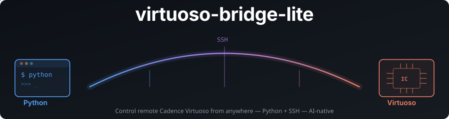

<p align="center">
  
</p>

<p align="center">
  <a href="https://github.com/Arcadia-1/virtuoso-bridge-lite/stargazers"></a>
  <a href="https://github.com/Arcadia-1/virtuoso-bridge-lite/network/members"></a>
  <a href="stats/README.md"></a>
  <a href="stats/README.md"></a>
</p>

<p align="center">
  <a href="https://github.com/Arcadia-1/virtuoso-bridge-lite/issues"></a>
  <a href="https://github.com/Arcadia-1/virtuoso-bridge-lite/commits/main"></a>
  <a href="https://virtuoso-bridge.tokenzhang.com"></a>
  <a href="LICENSE"></a>
  <a href="https://github.com/Arcadia-1/virtuoso-bridge-lite/pulls"></a>
</p>

<p align="center">
  <b><a href="https://virtuoso-bridge.tokenzhang.com">virtuoso-bridge.tokenzhang.com</a></b>
  &nbsp;·&nbsp; <a href="https://virtuoso-bridge.tokenzhang.com/guide/">Guide</a>
  &nbsp;·&nbsp; <a href="https://virtuoso-bridge.tokenzhang.com/guide/?lang=zh">中文文档</a>
</p>

Let AI agents drive Cadence Virtuoso and Spectre — locally or on a remote
server — from Python, SKILL or the command line.

```bash
git clone https://github.com/Arcadia-1/virtuoso-bridge-lite.git
cd virtuoso-bridge-lite
uv venv .venv && source .venv/bin/activate
uv pip install -e .

virtuoso-bridge init user@host   # write ~/.virtuoso-bridge/.env
virtuoso-bridge start            # prepare fixed-port setup and the SSH tunnel
# Paste the printed load("...") into the intended idle CIW.
virtuoso-bridge status
```

Setup, configuration, CLI reference, architecture and citation are in the
**[guide](https://virtuoso-bridge.tokenzhang.com/guide/)**. Coding agents start with [AGENTS.md](AGENTS.md).
Automatic sessions are opt-in: set `VB_AUTO_SESSIONS=1` and optionally
`VB_REMOTE_WORK_DIR=/projects/example` to discover a registered daemon using an
OS-assigned port. A working directory alone keeps the legacy fixed-port mode.
